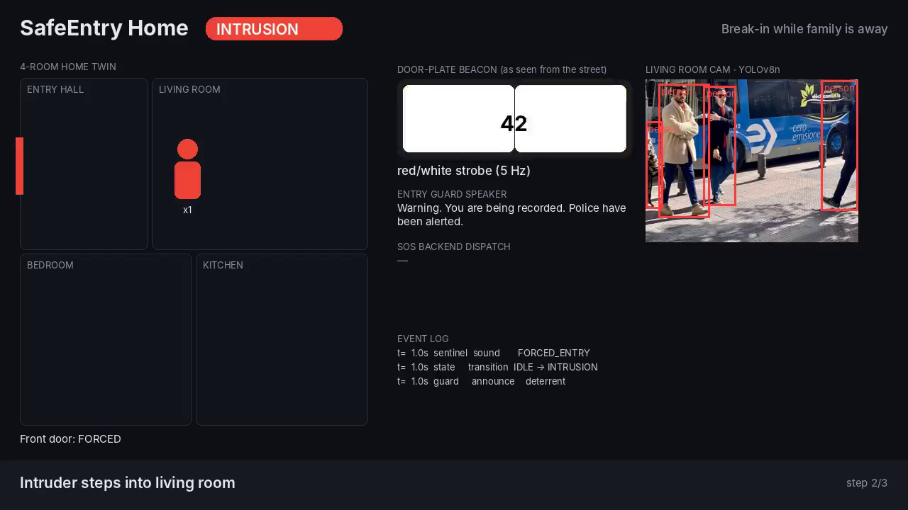
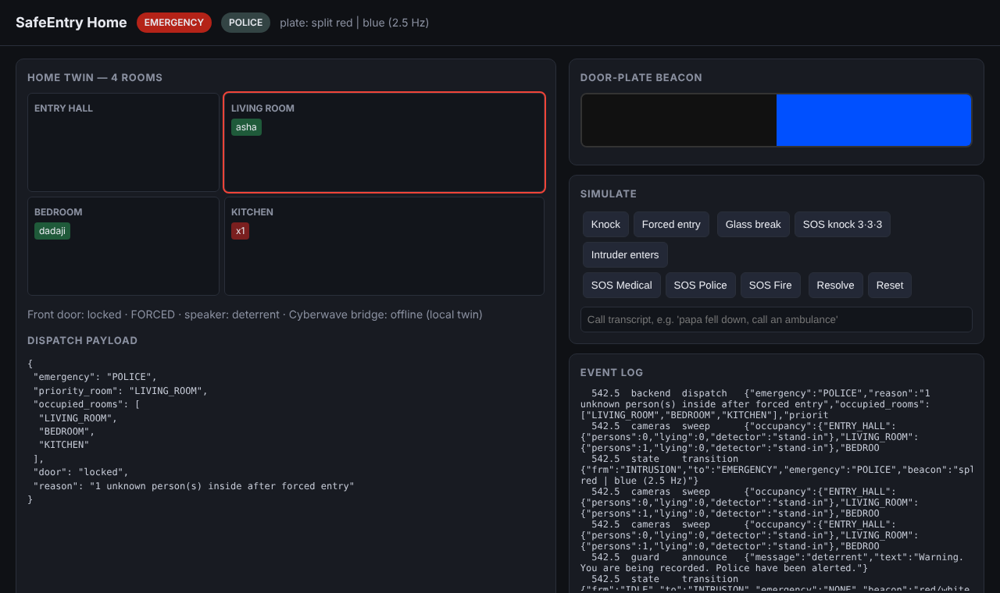

# SafeEntry Home

**Smart home security & emergency response that tells a knock from a break-in — and turns your door plate into a beacon responders can find.**

SafeEntry Home coordinates three linked subsystems in a simulated 4-room home under one state machine, backed by a FastAPI SOS and call-detection service.

| Subsystem | What it does |
|---|---|
| **Acoustic door-plate sentinel** | Classifies sounds at the door: everyday knock, forced entry, glass break, and a covert **3·3·3 SOS knock code** |
| **Entry guard** | Smart lock + outward speaker: greets visitors, plays deterrent audio and siren on intrusion, unlocks for paramedics |
| **Indoor camera responder** | Sweeps all 4 rooms (YOLOv8 person detection or a deterministic stand-in) to report occupancy and people lying down |
| **Door-plate beacon** | Makes the house findable: **blinking red** for medical, **split red / blue** for police, orange/white for fire, red/white strobe for intrusion |



## State machine

```
            knock                 forced entry / glass break
   IDLE ───────────▶ WATCH ─────────────────────────────▶ INTRUSION
    ▲  ◀──timeout 30s──┘                                      │ unknown person inside
    │                                                          ▼
    └──────── resolve() (owner / responder) ◀──────────── EMERGENCY {MEDICAL | POLICE | FIRE}
                                   ▲ SOS button · SOS knock code · distress in call
```

* Severity never drops on its own: only WATCH times out; INTRUSION and EMERGENCY need an explicit `resolve`.
* EMERGENCY can be upgraded (e.g. MEDICAL → POLICE if an intruder is found).
* Each EMERGENCY builds a **dispatch payload**: emergency type, occupied rooms, priority room (people lying down first), door status, and beacon pattern.

## Quick start

```bash
pip install -r requirements.txt
uvicorn api.main:app --reload        # dashboard at http://localhost:8000, API docs at /docs
pytest -q                            # 26 checks (YOLO tests skip if ultralytics is absent)
python tools/render_demo.py docs/safeentry_demo.mp4   # re-render the demo video
```



## API

| Method | Path | Purpose |
|---|---|---|
| GET | `/state` | Live state, beacon colours, people, dispatch, last 25 events |
| POST | `/sos` `{"type":"MEDICAL"}` | App / wearable SOS |
| POST | `/call/detect` `{"transcript":"..."}` | Distress detection in a call transcript (English + romanised Hindi, negation-aware) |
| POST | `/audio/classify` (WAV upload) | Run the sentinel on a real 16-bit WAV clip |
| POST | `/simulate/sound/{KNOCK\|FORCED_ENTRY\|GLASS_BREAK\|SOS_KNOCK\|AMBIENT}` | Inject a synthetic microphone clip |
| GET | `/simulate/sound/{label}.wav` | Download the synthetic clip |
| POST | `/simulate/person` | Move or add a person (resident / intruder) in the twin |
| POST | `/resolve`, `/reset` | Clear an incident, or reset the twin |
| GET | `/scenarios/check` | Run every automated scenario and return pass/fail |

## Automated scenarios

| Scenario | Expected outcome |
|---|---|
| `everyday_knock` | IDLE → WATCH → back to IDLE (no false alarm) |
| `break_in_empty_home` | INTRUSION → EMERGENCY/POLICE, priority room = living room |
| `glass_break_deterred` | INTRUSION, deterrent plays, owner resolves |
| `medical_fall` | EMERGENCY/MEDICAL, priority = kitchen (person lying), door unlocked for paramedics |
| `police_call` | Call transcript → EMERGENCY/POLICE |
| `silent_sos_knock` | 3·3·3 knock code → covert POLICE emergency |
| `negated_call` | "no need for an ambulance" → stays IDLE |

The audio classifier gets 100/100 correct per class on seeded synthetic clips (the test requires at least 48/50).

## Layout

```
safeentry/
  states.py        unified state machine + event model
  audio.py         synthetic mic stand-ins + onset/spectral acoustic classifier
  subsystems.py    sentinel, entry guard, camera responder (YOLOv8 / stand-in), beacon
  calls.py         call / voice distress detection
  coordinator.py   SafeEntry orchestrator + dispatch builder
  environment.py   4-room home twin + optional Cyberwave bridge (CYBERWAVE_API_KEY)
  scenarios.py     scripted scenarios used by tests, API and demo
api/               FastAPI backend + single-file live dashboard
tests/             pytest suite (state machine, audio, calls, beacon, scenarios, API, YOLO feeds)
tools/render_demo.py  renders docs/safeentry_demo.mp4 from the real engine
```

## Prototype scope and honesty notes

* All sensors are **simulated stand-ins**: microphone audio is synthesised; the camera feeds are a rendered top-down twin (stand-in detector) or sample photos for the YOLOv8 tests.
* The acoustic model is a transparent feature/rule classifier (onsets, level, spectral centroid, high-frequency ratio, knock grouping), designed to fit on a low-power door plate. It has the same interface a trained model (e.g. a YAMNet fine-tune) would plug into.
* The Cyberwave bridge publishes events when `CYBERWAVE_API_KEY` and the SDK are present. Otherwise it runs fully offline on the local twin.
* Real deployments would add authenticated resolve, encrypted transport, and integration with ERSS-112 / local emergency services.

## Credits

YOLOv8 by [Ultralytics](https://github.com/ultralytics/ultralytics) (AGPL-3.0). The camera-feed stand-in photo in the demo is Ultralytics' bundled `bus.jpg` sample. SafeEntry code is MIT licensed.
